# 🍽️ Flutter Production Packages — Build "Local Food Explorer"

> **You are not here to memorize nine package APIs.**
> You are here to build **one real app**, and to meet each package at the exact moment the app *needs* it.

By the end you will have a Cairo restaurant finder with login, navigation, a map, saved favorites, multiple environments, and clean state management — the same building blocks used in production Flutter apps.

---

## 🧭 How this tutorial works

Every chapter follows the same loop, so you always know where you are:

| Icon | Section | What it's for |
|---|---|---|
| 🧩 | **The Problem** | Feel the pain *before* seeing the cure |
| 💡 | **The Idea** | One sentence mental model |
| 🛠️ | **Build It** | Small, runnable steps |
| ⚠️ | **Traps** | Mistakes that cost people hours |
| ✅ | **Checkpoint** | Quick questions — answers are hidden, try first! |
| 🎯 | **Mission** | Add one feature to *Local Food Explorer* |
| 🏆 | **Boss Level** | Optional stretch for the curious |

**Prerequisites:** Flutter basics (widgets, `StatelessWidget` / `StatefulWidget`), Dart 3 syntax, and `async` / `await`.

> 📌 **Version note.** Packages move fast. This tutorial targets **go_router (current)**, **Freezed 3.x**, and **Riverpod 3.x**. If something doesn't compile, check the package's changelog on pub.dev *first* — it's usually a rename, not your fault.

---

## 🗺️ The Roadmap

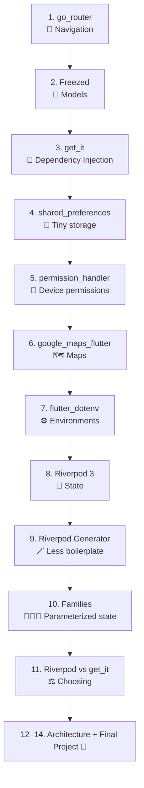

| # | Package | Superpower | ⏱️ Time |
|---|---|---|---|
| 1 | `go_router` | URLs, deep links, redirects | ~90 min |
| 2 | `freezed` | Immutable models, safe states | ~75 min |
| 3 | `get_it` | Stop creating dependencies by hand | ~45 min |
| 4 | `shared_preferences` | Remember small things | ~30 min |
| 5 | `permission_handler` | Ask the OS politely | ~45 min |
| 6 | `google_maps_flutter` | Put restaurants on a map | ~75 min |
| 7 | `flutter_dotenv` | Dev / staging / prod without code edits | ~45 min |
| 8 | `flutter_riverpod` | Reactive state | ~120 min |
| 9–11 | Generator, families, get_it comparison | Production polish | ~90 min |

### ✔️ Your progress tracker

Copy this into your notes and tick as you go:

- [ ] Ch 1 — Routing: login, restaurants list, details page
- [ ] Ch 2 — Models: `Restaurant` + `AuthState`
- [ ] Ch 3 — DI: fake API + repository wired with `get_it`
- [ ] Ch 4 — Prefs: onboarding flag + favorites persisted
- [ ] Ch 5 — Permissions: location flow with all outcomes handled
- [ ] Ch 6 — Maps: restaurants as tappable markers
- [ ] Ch 7 — Env: dev/staging/prod switch
- [ ] Ch 8 — Riverpod: restaurants + favorites as providers
- [ ] Ch 9 — Generator: providers converted to `@riverpod`
- [ ] Ch 10 — Families: details page driven by `restaurantProvider(id)`
- [ ] Ch 11 — Migration: repository moved from `get_it` into Riverpod
- [ ] Final — Polish, test, ship 🚀

---

## 🏗️ Chapter 0 — Set up the project

```bash
flutter create food_explorer
cd food_explorer
```

Start with this folder layout (create the empty folders now; you'll fill them chapter by chapter):

```text
lib/
├── main.dart
├── core/
│   ├── api/
│   ├── routes/
│   │   ├── router.dart
│   │   └── route_names.dart
│   └── storage/
└── features/
    ├── auth/
    ├── restaurants/
    └── map/
```

Run the app once to make sure your toolchain works. **Do this now** — debugging toolchain problems in Chapter 6 is much more painful.

---
---

# 1. 🧭 go_router

## 🧩 The Problem

The simplest Flutter navigation is:

```dart
Navigator.push(
  context,
  MaterialPageRoute(builder: (_) => const ProfileScreen()),
);
```

Perfect for a small app. But real apps soon need:

- 🔗 Deep links and web URLs (`/restaurants/42`)
- 🔒 Login guards (kick out strangers)
- 🧱 Nested navigation and bottom tabs
- 📦 Parameters in the URL

## 💡 The Idea

> **Your app is a map of URLs. Navigation means "go to this address."**

## 🛠️ Build It

### Step 1 — Install

```bash
flutter pub add go_router
```

### Step 2 — Create the router

`lib/app/router.dart`:

```dart
import 'package:go_router/go_router.dart';

final appRouter = GoRouter(
  routes: [
    GoRoute(
      path: '/',
      builder: (context, state) => const HomeScreen(),
    ),
    GoRoute(
      path: '/profile',
      builder: (context, state) => const ProfileScreen(),
    ),
  ],
);
```

### Step 3 — Plug it into the app

`lib/main.dart`:

```dart
void main() => runApp(const FoodExplorerApp());

class FoodExplorerApp extends StatelessWidget {
  const FoodExplorerApp({super.key});

  @override
  Widget build(BuildContext context) {
    return MaterialApp.router(
      title: 'Local Food Explorer',
      routerConfig: appRouter,
    );
  }
}
```

### Step 4 — Navigate

```dart
ElevatedButton(
  onPressed: () => context.go('/profile'),
  child: const Text('Open Profile'),
)
```

### Step 5 — `go()` vs `push()` (the most-confused pair)

| Method | Think of it as | Result |
|---|---|---|
| `context.go('/x')` | 🛰️ "Set my GPS destination to `/x`" | Replaces the location; the stack is rebuilt from the route tree |
| `context.push('/x')` | 🥞 "Put `/x` on top of the pile" | Adds a page; `context.pop()` removes it |

Rule of thumb: **use `go` for moving around the app, `push` for temporary things** (a picker, a modal-like page you return from).

### Step 6 — Nested routes (and a free back button!)

Our app needs `/restaurants` and `/restaurants/42`. Nest the details route **inside** the list route:

```dart
GoRoute(
  path: '/restaurants',
  name: 'restaurants',
  builder: (context, state) {
    final cuisine = state.uri.queryParameters['cuisine']; // ?cuisine=egyptian
    return RestaurantsScreen(cuisine: cuisine);
  },
  routes: [
    GoRoute(
      path: ':id', // ⚠️ no leading slash for child routes!
      name: 'restaurant',
      builder: (context, state) {
        final id = state.pathParameters['id']!;
        return RestaurantDetailsScreen(id: id);
      },
    ),
  ],
),
```

Now `context.go('/restaurants/42')` builds the stack **[Restaurants → Details]**, so the back button returns to the list. That's the payoff of nesting.

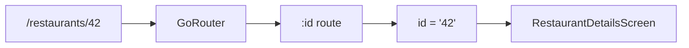

### Step 7 — Named routes (no more typo-prone strings)

```dart
context.goNamed(
  'restaurant',
  pathParameters: {'id': '42'},
  queryParameters: {'ref': 'home'},
);
```

### Step 8 — Passing objects with `extra`

```dart
context.push('/checkout', extra: order);

// receiving
final order = state.extra as Order;
```

Use **path / query parameters** when the URL should fully describe the screen (shareable, survives refresh). Use **`extra`** only for in-memory convenience.

### Step 9 — Redirects (login guard)

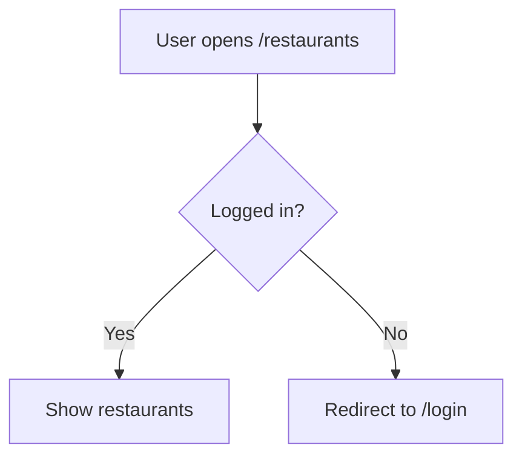

```dart
final authNotifier = ValueNotifier<bool>(false); // temporary; Riverpod replaces this later

final appRouter = GoRouter(
  refreshListenable: authNotifier, // re-run redirect when this changes
  redirect: (context, state) {
    final loggedIn = authNotifier.value;
    final onLogin = state.matchedLocation == '/login';

    if (!loggedIn && !onLogin) return '/login';
    if (loggedIn && onLogin) return '/';
    return null; // null = "all good, carry on"
  },
  routes: [ /* ... */ ],
);
```

## ⚠️ Traps

- **Leading slash on child paths** (`'/account'` instead of `'account'`) silently creates a *separate* top-level route.
- **Forgetting `refreshListenable`:** redirect only re-runs on navigation, so logging in won't move the user anywhere by itself.
- **`extra` is lost** on web refresh and when restoring app state. Never put something in `extra` that a deep link needs.
- **`go` when you meant `push`:** if "Back" behaves strangely, this is almost always why.
- **`state.pathParameters['id']!`** will crash if the route has no `:id` — the `!` is only safe because the path guarantees it.

## ✅ Checkpoint

1. You're on Home and call `context.go('/restaurants/42')`, with details nested under `/restaurants`. What does Back do?
2. Why is a child path written `'account'` instead of `'/account'`?
3. A user opens a shared link `/checkout` directly. Why might `extra: order` break?
4. What does `redirect` returning `null` mean?

<details>
<summary>👀 Answers</summary>

1. It returns to `/restaurants` — nesting gives `go` a proper stack.
2. Child paths are relative to the parent. A leading slash makes it an absolute, unrelated route.
3. A fresh deep link has no in-memory `extra`, so `state.extra` is `null` and the cast crashes.
4. "No redirect — continue to the requested location."
</details>

## 🎯 Mission 1 — Skeleton of the app

Create these screens with **placeholder text only** (no real data yet):

| Route | Screen |
|---|---|
| `/login` | Login (button: "Pretend to log in" → sets `authNotifier.value = true`) |
| `/` | Home (button → restaurants) |
| `/restaurants?cuisine=egyptian` | List (shows the cuisine from the query) |
| `/restaurants/:id` | Details (shows the id) |

**Done when:** opening the app lands on `/login`, logging in lands on `/`, and Back from details returns to the list.

## 🏆 Boss Level

Add a `ShellRoute` (or `StatefulShellRoute`) with a bottom navigation bar for **Home / Map / Settings**.

## 📋 Cheat sheet

```text
GoRouter
├── GoRoute(path, name, builder, routes: [...])
├── context.go() / push() / pop()
├── context.goNamed(name, pathParameters:, queryParameters:)
├── state.pathParameters / state.uri.queryParameters / state.extra
└── redirect + refreshListenable
```

---
---

# 2. 🧊 Freezed

## 🧩 The Problem

A normal Dart model:

```dart
class User {
  final String id;
  final String name;
  User({required this.id, required this.name});
}
```

Try this and see what's missing:

```dart
print(User(id: '1', name: 'Mona') == User(id: '1', name: 'Mona')); // false 😬
```

Production apps need **value equality, `copyWith`, JSON, and safe state types**. Writing them by hand is slow and bug-prone, so we let a code generator do it.

## 💡 The Idea

> **Describe the shape of your data once. Let the generator write the boring parts.**

## 🛠️ Build It

### Step 1 — Install

```bash
flutter pub add freezed_annotation json_annotation
flutter pub add --dev freezed json_serializable build_runner
```

### Step 2 — Your first model

`lib/features/restaurants/restaurant.dart`:

```dart
import 'package:freezed_annotation/freezed_annotation.dart';

part 'restaurant.freezed.dart';
part 'restaurant.g.dart';

@freezed
abstract class Restaurant with _$Restaurant {
  const factory Restaurant({
    required String id,
    required String name,
    required String cuisine,
    required double rating,
    required double lat,
    required double lng,
    @Default(false) bool isOpen,
  }) = _Restaurant;

  factory Restaurant.fromJson(Map<String, dynamic> json) =>
      _$RestaurantFromJson(json);
}
```

> 📌 In **Freezed 3**, a model with a single constructor must be declared `abstract class` (and union types `sealed class`). Older tutorials show plain `class` — that no longer compiles.

### Step 3 — Generate

```bash
dart run build_runner build --delete-conflicting-outputs
```

While developing, keep it running so it regenerates on every save:

```bash
dart run build_runner watch --delete-conflicting-outputs
```

### Step 4 — Meet your free superpowers

**Equality**

```dart
const a = Restaurant(id: '1', name: 'Koshary Corner', cuisine: 'egyptian', rating: 4.6, lat: 30.04, lng: 31.23);
final b = a.copyWith();
print(a == b); // true ✅
```

**`copyWith` — never mutate, always copy**

```dart
final closed = a.copyWith(isOpen: false); // `a` is untouched
```

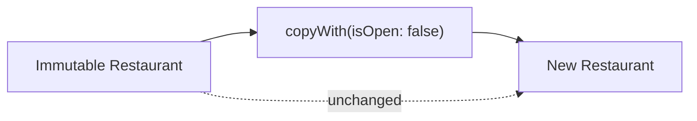

**JSON**

```dart
final r = Restaurant.fromJson(jsonMap);
final map = r.toJson();
```

### Step 5 — Union types: states that can't lie

The classic mess:

```dart
bool isLoading;
String? error;
User? user;
// What does isLoading == true && error != null mean? 🤷
```

The Freezed way — **exactly one state at a time**:

```dart
@freezed
sealed class AuthState with _$AuthState {
  const factory AuthState.initial() = AuthInitial;
  const factory AuthState.loading() = AuthLoading;
  const factory AuthState.authenticated(User user) = AuthAuthenticated;
  const factory AuthState.failure(String message) = AuthFailure;
}
```

Use Dart 3 pattern matching — the compiler checks you covered every case:

```dart
final label = switch (state) {
  AuthInitial() => 'Welcome!',
  AuthLoading() => 'Signing in…',
  AuthAuthenticated(:final user) => 'Hi ${user.name} 👋',
  AuthFailure(:final message) => 'Oops: $message',
};
```

> 🧪 **Try it:** add a fifth state, `AuthState.locked()`. Watch the compiler flag every `switch` that forgot about it. That's the feature.

## ⚠️ Traps

- **Forgot the `part` lines** → "`_$Restaurant` isn't defined". The file name in `part` must match exactly.
- **Forgot to re-run `build_runner`** after editing a model → stale generated code.
- **Naming union cases `Error`, `Loading`, `Success`** can collide with `dart:core` types (`Error` does!). Prefix them: `AuthFailure`, `AuthLoading`.
- **Old tutorials use `.when()` / `.map()` on Freezed unions.** Freezed 3 moved to native pattern matching (`switch`), as shown above.
- **Don't commit stale `*.g.dart` conflicts** — decide as a team whether generated files are committed or built in CI.

## ✅ Checkpoint

1. Why does `User(id: '1') == User(id: '1')` return `false` for a hand-written class?
2. Why is `copyWith` preferred over `user.name = 'Ahmed'`?
3. What does `sealed` buy you in a `switch`?
4. You edited a Freezed model and got weird errors. First thing to try?

<details>
<summary>👀 Answers</summary>

1. Dart compares object identity by default; Freezed generates `==` and `hashCode` from the fields.
2. Immutable data is predictable: if a value changed, a *new* object exists, so UI and state libraries can detect it reliably.
3. Exhaustiveness: the compiler errors if you forget a case.
4. Re-run `dart run build_runner build --delete-conflicting-outputs`.
</details>

## 🎯 Mission 2 — Real models

1. Create `Restaurant` (above) and a `User` model (`id`, `name`, `email`).
2. Create `AuthState` and print a different label for each state in a throwaway screen.
3. Hard-code three restaurants as JSON and parse them with `Restaurant.fromJson`:

```dart
const sampleJson = [
  {'id': '1', 'name': 'Koshary Corner', 'cuisine': 'egyptian', 'rating': 4.6, 'lat': 30.0444, 'lng': 31.2357, 'isOpen': true},
  {'id': '2', 'name': 'Zamalek Grill',  'cuisine': 'grill',    'rating': 4.3, 'lat': 30.0626, 'lng': 31.2197},
  {'id': '3', 'name': 'Nile Pizza Co.', 'cuisine': 'pizza',    'rating': 4.1, 'lat': 30.0500, 'lng': 31.2400, 'isOpen': true},
];
```

**Done when:** `Restaurant.fromJson(sampleJson[0]) == Restaurant.fromJson(sampleJson[0])` prints `true`.

## 🏆 Boss Level

Add a `@JsonKey(name: 'image_url') String? imageUrl` field and make the generator map the snake_case API field.

---

# 3. 🔌 get_it

## 🧩 The Problem

Look at this repository:

```dart
class RestaurantRepository {
  final ApiClient apiClient = ApiClient(); // 😬 builds its own dependency
}
```

It's impossible to swap in a fake API for testing, and every class that creates its own `ApiClient` gets a *different* one.

Better — **receive** the dependency:

```dart
class RestaurantRepository {
  RestaurantRepository(this.apiClient);
  final ApiClient apiClient;
}
```

That is **dependency injection (DI)**. Now the question becomes: *who builds and hands out these objects?*

## 💡 The Idea

> **`get_it` is a registry: register things once at startup, ask for them anywhere.** Think of a restaurant kitchen: chefs don't buy their own knives, the kitchen supplies them.

## 🛠️ Build It

### Step 1 — Install

```bash
flutter pub add get_it
```

### Step 2 — Three ways to register

| Registration | Created when? | Same object every time? | Use for |
|---|---|---|---|
| `registerSingleton` | Immediately | ✅ | Things needed at startup |
| `registerLazySingleton` | On first request | ✅ | Most services (default choice) |
| `registerFactory` | Every request | ❌ new each time | Short-lived objects (controllers) |

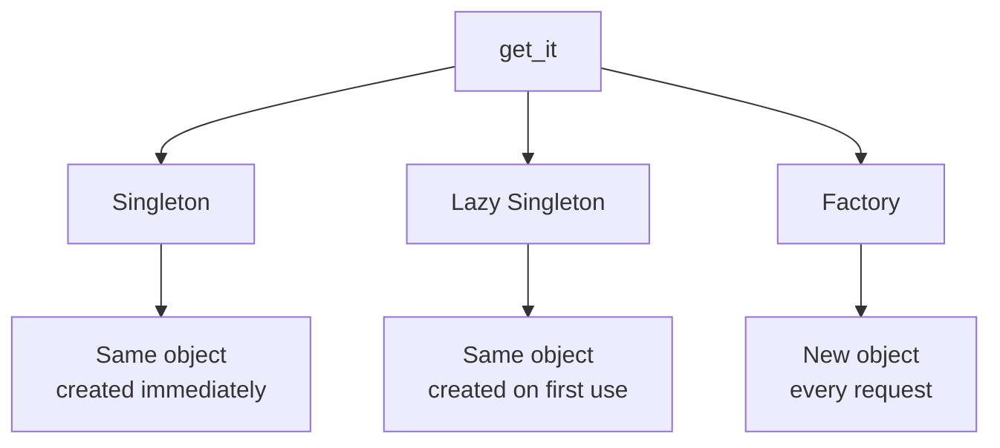

### Step 3 — A swappable API (this is why DI matters)

`lib/core/api/api_client.dart`:

```dart
abstract class ApiClient {
  Future<List<Map<String, dynamic>>> getRestaurants();
}

class FakeApiClient implements ApiClient {
  @override
  Future<List<Map<String, dynamic>>> getRestaurants() async {
    await Future<void>.delayed(const Duration(milliseconds: 800)); // pretend network
    return sampleRestaurantJson; // the list from Mission 2
  }
}
```

`lib/features/restaurants/restaurant_repository.dart`:

```dart
class RestaurantRepository {
  RestaurantRepository(this._api);
  final ApiClient _api;

  Future<List<Restaurant>> getAll() async {
    final raw = await _api.getRestaurants();
    return raw.map(Restaurant.fromJson).toList();
  }

  Future<Restaurant> getById(String id) async =>
      (await getAll()).firstWhere((r) => r.id == id);
}
```

### Step 4 — Register everything in one place

`lib/core/di.dart`:

```dart
import 'package:get_it/get_it.dart';

final getIt = GetIt.instance;

Future<void> setupDependencies() async {
  getIt.registerLazySingleton<ApiClient>(() => FakeApiClient());
  getIt.registerLazySingleton<RestaurantRepository>(
    () => RestaurantRepository(getIt<ApiClient>()),
  );
}
```

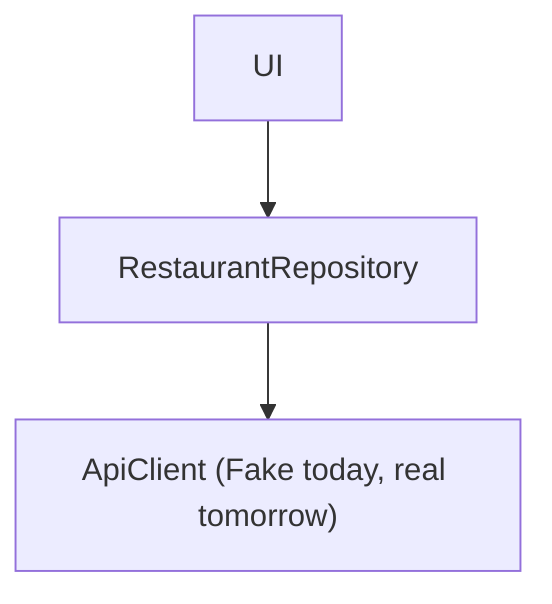

### Step 5 — Call it before `runApp`

```dart
Future<void> main() async {
  WidgetsFlutterBinding.ensureInitialized();
  await setupDependencies();
  runApp(const FoodExplorerApp());
}
```

Swapping to a real API later is **one line** in `setupDependencies()` — no screen changes.

## ⚠️ Traps

- **Using `getIt` before `setupDependencies()` ran** → "not registered" error. Always set up before `runApp`.
- **Registering the same type twice** throws. In tests, call `getIt.reset()` between tests.
- **Sprinkling `getIt<...>()` through widgets** turns DI into a hidden global. Resolve at the edges and pass things in.
- **Picking `registerFactory` for something with state you expect to share** (e.g. a cache) — you'll silently get a new, empty one each time.

## ✅ Checkpoint

1. Which registration would you use for an `ApiClient` shared across the app, created only when first needed?
2. What is the single biggest benefit of making `ApiClient` an `abstract class`?
3. What happens if you request an unregistered type?

<details>
<summary>👀 Answers</summary>

1. `registerLazySingleton`.
2. You can swap implementations (fake ⇄ real ⇄ mock in tests) without touching consumers.
3. A runtime error — which is why registration belongs at startup in one function.
</details>

## 🎯 Mission 3 — Real data flows

1. Create `ApiClient`, `FakeApiClient`, `RestaurantRepository`.
2. Register them in `setupDependencies()`.
3. On `/restaurants`, call `getIt<RestaurantRepository>().getAll()` inside a `FutureBuilder` and show the names.

**Done when:** you see a spinner for ~1 second, then three restaurants.

> 🧠 Notice how clumsy `FutureBuilder` + manual loading/error handling feels. Hold that thought — Chapter 8 fixes it.

## 🏆 Boss Level

Write a second class, `SlowFakeApiClient`, that throws on every call. Swap it in and make the list screen show a friendly error.

---
---

# 4. 💾 shared_preferences

## 🧩 The Problem

The user finished onboarding, picked their favorite restaurants, chose dark mode… and then closed the app. When they come back, everything is gone. We need **tiny, persistent storage.**

## 💡 The Idea

> **A small key-value notebook that survives app restarts.** Not a database.

| ✅ Good for | ❌ Not for |
|---|---|
| `onboardingCompleted`, theme, language, simple flags, small lists of ids | Auth tokens (use `flutter_secure_storage`), large or relational data (use SQLite / Drift / Isar / Hive) |

## 🛠️ Build It

### Step 1 — Install

```bash
flutter pub add shared_preferences
```

### Step 2 — Write, read, remove

```dart
final prefs = await SharedPreferences.getInstance();

// write
await prefs.setBool('onboarding_completed', true);
await prefs.setString('language', 'en');
await prefs.setInt('launch_count', 10);
await prefs.setStringList('favorite_ids', ['1', '3']);

// read (always nullable — it may never have been saved!)
final done = prefs.getBool('onboarding_completed') ?? false;
final favs = prefs.getStringList('favorite_ids') ?? [];

// delete
await prefs.remove('language');
await prefs.clear(); // nukes everything
```

### Step 3 — Wrap it in a service (keep storage details out of the UI)

`lib/core/storage/preferences_service.dart`:

```dart
class PreferencesService {
  PreferencesService(this._prefs);
  final SharedPreferences _prefs;

  static const _onboardingKey = 'onboarding_completed';
  static const _favoritesKey = 'favorite_restaurant_ids';

  bool get onboardingCompleted => _prefs.getBool(_onboardingKey) ?? false;
  Future<void> completeOnboarding() => _prefs.setBool(_onboardingKey, true);

  Set<String> get favoriteIds =>
      (_prefs.getStringList(_favoritesKey) ?? const []).toSet();
  Future<void> saveFavorites(Set<String> ids) =>
      _prefs.setStringList(_favoritesKey, ids.toList());
}
```

### Step 4 — Wire it into `get_it` (Chapters 3 + 4 shaking hands 🤝)

```dart
Future<void> setupDependencies() async {
  final prefs = await SharedPreferences.getInstance();
  getIt.registerSingleton<PreferencesService>(PreferencesService(prefs));
  // ...ApiClient, RestaurantRepository
}
```

## ⚠️ Traps

- **Magic strings.** `'onboarding_completed'` typed in five places = one typo away from a bug. Use constants (as above).
- **Reading returns `null`** the first time. Always provide a default with `??`.
- **It is not encrypted.** Never store passwords or tokens here.
- **Newer API alert.** The package also offers `SharedPreferencesAsync` and `SharedPreferencesWithCache`. Decide which your course targets (check the package's pub.dev page); the *concepts* here are identical.

## ✅ Checkpoint

1. Why does `getBool` return `bool?` instead of `bool`?
2. Where would you store a login token? Why not here?
3. Why wrap `SharedPreferences` in `PreferencesService`?

<details>
<summary>👀 Answers</summary>

1. The key might never have been written.
2. In secure storage (Keychain / Keystore). Shared preferences is plain, unencrypted storage.
3. One place owns the keys and defaults; screens don't know (or care) how data is stored, and you can fake the service in tests.
</details>

## 🎯 Mission 4 — The app remembers you

1. Add an **Onboarding** screen (route `/onboarding`) shown only until the user taps "Get started" (`completeOnboarding()`).
2. Add a ❤️ button on each restaurant row that saves/removes the id via `saveFavorites`.
3. Fully close and reopen the app.

**Done when:** onboarding never reappears and your hearts are still there.

## 🏆 Boss Level

Store the selected `ThemeMode` and apply it at app start.

---
---

# 5. 🔐 permission_handler

## 🧩 The Problem

We want to center the map on the user — but **Android and iOS decide** whether we're allowed to know where they are. Our app can only *ask*.

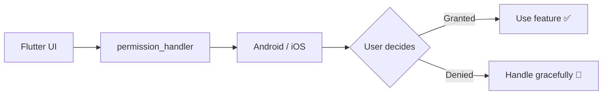

## 💡 The Idea

> **Permissions are a conversation, not a switch.** Always plan for *yes*, *no*, and *"never ask me again."*

## 🛠️ Build It

### Step 1 — Install

```bash
flutter pub add permission_handler
```

### Step 2 — Platform setup (the step everyone forgets 🙈)

A Dart package can't bypass the OS. Flutter code → `permission_handler` → **native config** → operating system.

**Android** — `android/app/src/main/AndroidManifest.xml` (above `<application>`):

```xml
<uses-permission android:name="android.permission.ACCESS_FINE_LOCATION"/>
<uses-permission android:name="android.permission.ACCESS_COARSE_LOCATION"/>
```

**iOS** — `ios/Runner/Info.plist`:

```xml
<key>NSLocationWhenInUseUsageDescription</key>
<string>We use your location to show restaurants near you.</string>
```

**iOS** — `ios/Podfile`: enable only the permissions you use, inside `post_install`:

```ruby
target.build_configurations.each do |config|
  config.build_settings['GCC_PREPROCESSOR_DEFINITIONS'] ||= [
    '$(inherited)',
    'PERMISSION_LOCATION=1',
  ]
end
```

### Step 3 — Check, request, react

```dart
final status = await Permission.locationWhenInUse.status;
```

| Status | Meaning | What to do |
|---|---|---|
| `isGranted` | You're in 🎉 | Use the feature |
| `isDenied` | Not yet / said no once | You may ask again |
| `isPermanentlyDenied` | "Don't ask again" | Send them to app settings |
| `isRestricted` | OS policy (e.g. parental controls) | Explain; don't nag |

### Step 4 — One reusable function

```dart
enum LocationAccess { granted, denied, blocked }

Future<LocationAccess> ensureLocationAccess() async {
  var status = await Permission.locationWhenInUse.status;
  if (status.isGranted) return LocationAccess.granted;
  if (status.isPermanentlyDenied || status.isRestricted) return LocationAccess.blocked;

  status = await Permission.locationWhenInUse.request();
  if (status.isGranted) return LocationAccess.granted;
  if (status.isPermanentlyDenied || status.isRestricted) return LocationAccess.blocked;
  return LocationAccess.denied;
}
```

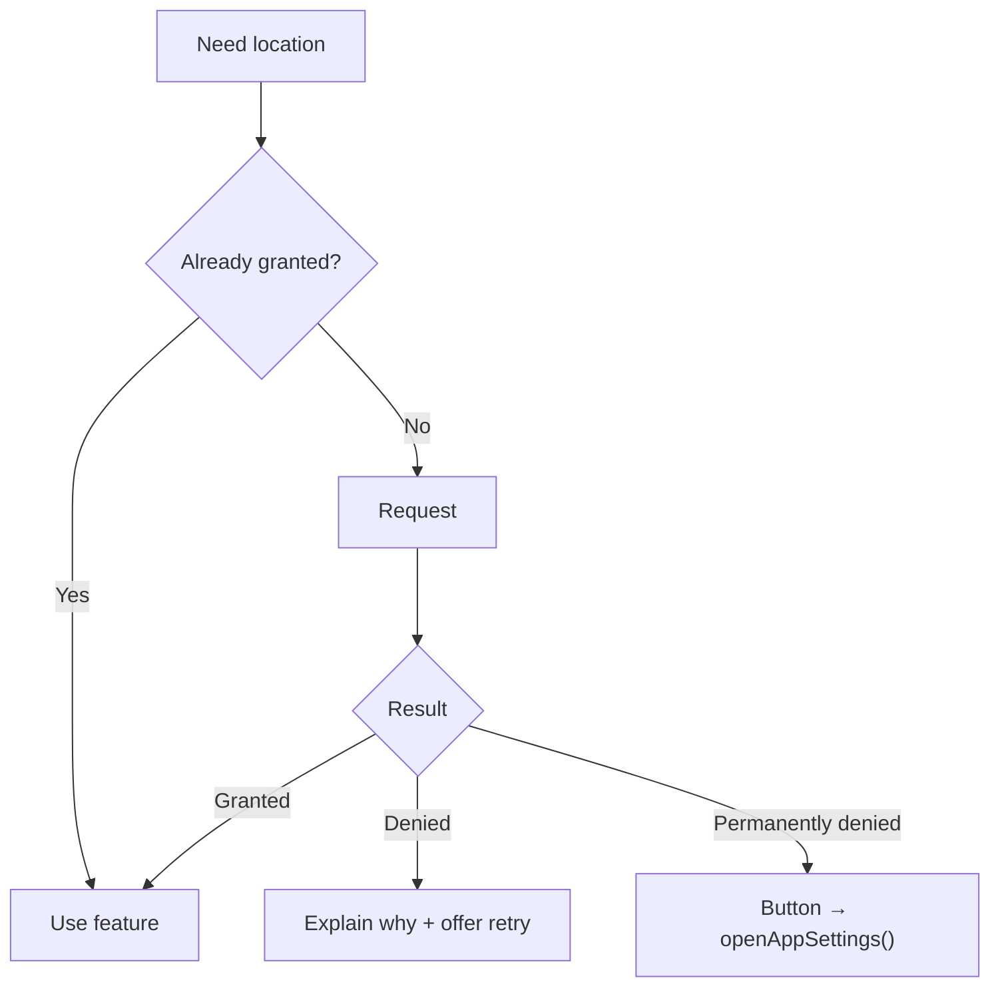

### Step 5 — Respond like a human

```dart
switch (await ensureLocationAccess()) {
  case LocationAccess.granted: _centerOnUser();
  case LocationAccess.denied:  _showSnack('We need location to find restaurants near you.');
  case LocationAccess.blocked: await openAppSettings();
}
```

## ⚠️ Traps

- **Skipped native config** → the request silently returns "denied" with no prompt. 90% of "permission_handler is broken" posts.
- **Asking at app launch with no context.** Explain *why* first ("Show restaurants near you?") and ask when the user taps the feature. On iOS you often get **one** shot.
- **Treating "denied" as the end.** Always give the user a path forward.
- **Requesting more permissions than needed.** Fewer prompts = more trust.

## ✅ Checkpoint

1. You call `request()` and nothing appears on screen. What's the most likely cause?
2. What should you do when a permission is permanently denied?
3. Why prefer `locationWhenInUse` over `locationAlways`?

<details>
<summary>👀 Answers</summary>

1. Missing Android manifest entry / iOS `Info.plist` key / Podfile macro.
2. Explain and offer `openAppSettings()`; the OS won't show the dialog again.
3. Least privilege — you only need location while the app is open, and users trust it more.
</details>

## 🎯 Mission 5 — "Near me" button

Add a button on the Map screen: **"📍 Near me"** that runs `ensureLocationAccess()` and shows a different message for each of the three outcomes.

**Done when:** you've personally tested *granted*, *denied*, and *permanently denied* (toggle in phone settings between runs).

## 🏆 Boss Level

Show a friendly "pre-permission" bottom sheet *before* the OS dialog, and only call `request()` if the user taps "Continue."

---
---

# 6. 🗺️ google_maps_flutter

## 🧩 The Problem

A list of restaurants is fine. A **map** of restaurants is how people actually decide where to eat.

```text
GoogleMap → Camera → Markers → Tap a marker → Details page
```

## 💡 The Idea

> **A map is a widget with a camera. Markers are just data you describe; you move the camera with a controller.**

## 🛠️ Build It

### Step 1 — Install

```bash
flutter pub add google_maps_flutter
```

### Step 2 — API key (native config again!)

Create a key in Google Cloud Console (enable *Maps SDK for Android* and *Maps SDK for iOS*), then:

**Android** — inside `<application>` in `AndroidManifest.xml`:

```xml
<meta-data
    android:name="com.google.android.geo.API_KEY"
    android:value="YOUR_KEY_HERE"/>
```

**iOS** — `ios/Runner/AppDelegate.swift`:

```swift
import GoogleMaps
// inside application(_:didFinishLaunchingWithOptions:)
GMSServices.provideAPIKey("YOUR_KEY_HERE")
```

> 🔑 These native keys are **not** read from `.env` (Chapter 7). Restrict your key by package name / SHA-1 / bundle ID in the Cloud Console.

### Step 3 — A map in 6 lines

```dart
const GoogleMap(
  initialCameraPosition: CameraPosition(
    target: LatLng(30.0444, 31.2357), // Downtown Cairo
    zoom: 12,
  ),
)
```

### Step 4 — Markers from real data

Don't hand-write markers — **derive them from your list**:

```dart
Set<Marker> _buildMarkers(List<Restaurant> restaurants) => {
  for (final r in restaurants)
    Marker(
      markerId: MarkerId(r.id),
      position: LatLng(r.lat, r.lng),
      infoWindow: InfoWindow(
        title: r.name,
        snippet: '${r.cuisine} • ⭐ ${r.rating}',
        onTap: () => context.go('/restaurants/${r.id}'), // Chapter 1 meets Chapter 6 🎉
      ),
    ),
};
```

### Step 5 — Controlling the camera

```dart
class RestaurantsMap extends StatefulWidget {
  const RestaurantsMap({super.key, required this.restaurants});
  final List<Restaurant> restaurants;

  @override
  State<RestaurantsMap> createState() => _RestaurantsMapState();
}

class _RestaurantsMapState extends State<RestaurantsMap> {
  GoogleMapController? _controller;

  Future<void> _moveTo(LatLng target) async {
    await _controller?.animateCamera(CameraUpdate.newLatLngZoom(target, 15));
  }

  @override
  Widget build(BuildContext context) {
    return Scaffold(
      body: GoogleMap(
        initialCameraPosition: const CameraPosition(target: LatLng(30.0444, 31.2357), zoom: 12),
        markers: _buildMarkers(widget.restaurants),
        onMapCreated: (c) => _controller = c,
      ),
      floatingActionButton: FloatingActionButton(
        onPressed: () => _moveTo(const LatLng(30.0444, 31.2357)),
        child: const Icon(Icons.my_location),
      ),
    );
  }
}
```

### Step 6 — Combine with permissions

```mermaid
flowchart LR
    A[Tap "Near me"] --> B[permission_handler]
    B --> C[Location granted]
    C --> D["Get GPS position"]
    D --> E[GoogleMap]
    E --> F[Move camera]
    E --> G[Show user marker]
```

> 🧭 **Missing piece:** `permission_handler` only grants *permission*. To read the actual GPS coordinates add a location package such as `geolocator` (`Geolocator.getCurrentPosition()`). Note `geolocator` has its own permission helpers too — in a real project you might use just one of the two.
> Once permission is granted you can also set `myLocationEnabled: true` on `GoogleMap` for the blue dot.

## ⚠️ Traps

- **Grey map / blank tiles** → missing or unrestricted-wrong API key, or the SDK isn't enabled for that platform.
- **Android emulator without Google Play services** shows no map. Use a "Google Play" system image.
- **Mutating the marker set** doesn't rebuild; always pass a **new** `Set<Marker>`.
- **Using the controller before `onMapCreated`** → it's `null`. Keep it nullable (`?.`).
- **Billing:** Google Maps requires a billing-enabled Cloud project, even within the free tier.

## ✅ Checkpoint

1. Where do native map API keys live, and why can't `flutter_dotenv` supply them?
2. Why derive markers from the restaurant list instead of hardcoding them?
3. What is `GoogleMapController` for?

<details>
<summary>👀 Answers</summary>

1. In `AndroidManifest.xml` / `AppDelegate.swift`; native code reads them before Dart even starts.
2. The map then always reflects the data (and filters, search, favorites…) automatically.
3. Imperatively moving the camera, zooming, animating, etc.
</details>

## 🎯 Mission 6 — Map of Cairo

1. Show all three restaurants as markers.
2. Tapping a marker's info window navigates to `/restaurants/:id`.
3. The "Near me" button from Mission 5 recenters the camera (use Cairo as a fallback if GPS isn't wired yet).

**Done when:** Map → marker → details → Back returns you to the list.

## 🏆 Boss Level

Make markers for favorited restaurants a different color using `BitmapDescriptor.defaultMarkerWithHue`.

---

# 7. ⚙️ flutter_dotenv & Environment Management

## 🧩 The Problem

Your API URL is hardcoded in 14 files. Then the backend team says: *"Use the staging server for testing."* You edit 14 files, forget one, and your test build **writes fake orders to production.** 💥

## 💡 The Idea

> **Code stays the same. Configuration changes per environment.**

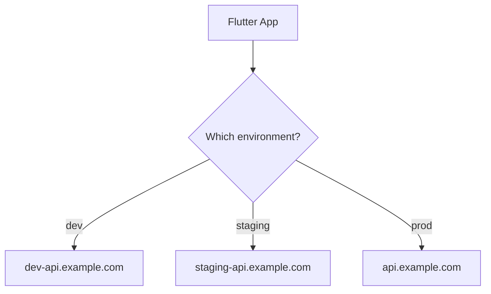

## 🛠️ Build It

### Step 1 — Install

```bash
flutter pub add flutter_dotenv
```

### Step 2 — Create one file per environment (project root)

`.env.dev`

```env
API_BASE_URL=https://dev-api.example.com
APP_NAME=Food Explorer (DEV)
```

`.env.staging`

```env
API_BASE_URL=https://staging-api.example.com
APP_NAME=Food Explorer (STG)
```

`.env.prod`

```env
API_BASE_URL=https://api.example.com
APP_NAME=Food Explorer
```

### Step 3 — Don't skip this: register them as assets

`pubspec.yaml`:

```yaml
flutter:
  assets:
    - .env.dev
    - .env.staging
    - .env.prod
```

> Without this, `dotenv.load()` throws a "file not found" error. It's the #1 flutter_dotenv stumbling block.

### Step 4 — Git hygiene

```gitignore
# .gitignore
.env*
!.env.example
```

Commit a `.env.example` with **fake values** so teammates know which keys exist.

### Step 5 — Choose the environment at launch

```dart
// lib/app/env.dart
import 'package:flutter_dotenv/flutter_dotenv.dart';

abstract final class Env {
  /// Picked at build time: flutter run --dart-define=ENV=staging
  static const name = String.fromEnvironment('ENV', defaultValue: 'dev');

  static String get apiBaseUrl => dotenv.get('API_BASE_URL'); // throws if missing
  static String get appName => dotenv.get('APP_NAME');

  static bool get isProd => name == 'prod';
}
```

```dart
Future<void> main() async {
  WidgetsFlutterBinding.ensureInitialized();
  await dotenv.load(fileName: '.env.${Env.name}');
  await setupDependencies();
  runApp(const FoodExplorerApp());
}
```

Run it:

```bash
flutter run --dart-define=ENV=dev
flutter run --dart-define=ENV=staging
flutter build apk --dart-define=ENV=prod
```

Why wrap `dotenv.env[...]` in `Env`?

| Scattered `dotenv.env['API_BASE_URL']` | One `Env` class |
|---|---|
| Typos fail silently at runtime | One place to fix a typo |
| `String?` everywhere | Clean `String` |
| Hard to find all config | One file lists all config |

And `dotenv.get(...)` **fails loudly** when a key is missing — far better than the silent `?? ''` fallback, which turns a config mistake into a mysterious "request to empty URL" bug later.

## 🔒 Honest talk: `.env` is configuration, **not** secrecy

```text
Environment configuration  ≠  Secret security
```

Anything bundled into a mobile app can be extracted by a determined person. So:

- ✅ Fine in `.env`: base URLs, feature flags, **restricted** public client keys (like a package-restricted Maps key).
- ❌ Never in `.env`: database passwords, private API secrets, signing keys. Those live on **your server**.

## ⚠️ Traps

- **Forgot the `assets:` entry** → file-not-found at startup.
- **All three env files get bundled** into every build, including prod. Harmless config here, but it's sloppy; for stricter setups look at Flutter **flavors**, or the built-in `--dart-define-from-file=env/prod.json` approach, which avoids shipping unused files.
- **Committing real `.env` files** with real keys.
- **Calling `Env.apiBaseUrl` before `dotenv.load()`** → throws `NotInitializedError`.

## ✅ Checkpoint

1. Why is `dotenv.get('KEY')` safer than `dotenv.env['KEY'] ?? ''`?
2. Is a value in `.env` safe from users who download your app? Why / why not?
3. How does the app know which `.env.*` file to load?

<details>
<summary>👀 Answers</summary>

1. It fails immediately and clearly instead of hiding a misconfiguration.
2. No — it ships inside the app bundle and can be extracted. Real secrets belong server-side.
3. `--dart-define=ENV=...` → `String.fromEnvironment` → `dotenv.load(fileName: '.env.$name')`.
</details>

## 🎯 Mission 7 — Dev / Staging / Prod

1. Create the three env files and the `Env` class.
2. Show a red **DEV** / orange **STG** banner (e.g. `Banner` widget) when `!Env.isProd`.
3. Print the active `API_BASE_URL` on the Settings screen.

**Done when:** launching with each `--dart-define=ENV=...` visibly changes the banner and URL **without touching any Dart code.**

## 🏆 Boss Level

Use `Env.apiBaseUrl` in a real `ApiClient` built with `dio`, and register it in `get_it` only when `Env.isProd` is true (fake client otherwise).

---
---

# 8. 🧠 Riverpod 3

## 🧩 The Problem

Remember how messy the `FutureBuilder` felt in Chapter 3? Now multiply it:

```text
User · Restaurants · Favorites · Auth · Theme · Settings
        + loading + error + refresh + caching …
```

Who owns this state? Who rebuilds when it changes? How do two screens share it without passing it through 6 constructors?

## 💡 The Idea

> **Riverpod keeps your app's state *outside* the widget tree, and widgets simply *watch* it.**

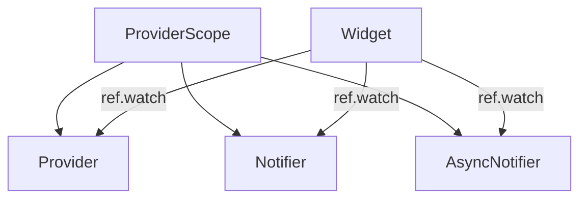

## 🛠️ Build It

### Step 1 — Install & wrap the app

```bash
flutter pub add flutter_riverpod
```

```dart
void main() async {
  // ...dotenv + setupDependencies...
  runApp(const ProviderScope(child: FoodExplorerApp()));
}
```

### Step 2 — Your first `Provider`: a read-only value

```dart
final greetingProvider = Provider<String>((ref) => 'Hungry? 🍽️');
```

Widgets that read providers extend `ConsumerWidget`:

```dart
class GreetingText extends ConsumerWidget {
  const GreetingText({super.key});

  @override
  Widget build(BuildContext context, WidgetRef ref) {
    final greeting = ref.watch(greetingProvider);
    return Text(greeting);
  }
}
```

### Step 3 — `watch` vs `read` vs `listen`

| Call | Meaning | Use it |
|---|---|---|
| `ref.watch(p)` | "Give me the value **and rebuild me when it changes**" | Inside `build` ✅ |
| `ref.read(p)` | "Give me the value **once, right now**" | Inside callbacks (`onPressed`) ✅ |
| `ref.listen(p, …)` | "Run **side effects** when it changes" (snackbars, navigation) | Inside `build` for effects |

> 🧠 **Golden rule:** *watch in `build`, read in callbacks.* Calling `ref.read` in `build` gives you a UI that never updates; calling `ref.watch` in `onPressed` throws an error.

### Step 4 — `Notifier`: state you can change

A notifier **owns** a piece of state and exposes the only ways to change it.

```dart
class CounterNotifier extends Notifier<int> {
  @override
  int build() => 0; // initial state

  void increment() => state++;
}

final counterProvider =
    NotifierProvider<CounterNotifier, int>(CounterNotifier.new);
```

```dart
class CounterScreen extends ConsumerWidget {
  const CounterScreen({super.key});

  @override
  Widget build(BuildContext context, WidgetRef ref) {
    final count = ref.watch(counterProvider);
    return Column(
      children: [
        Text('$count'),
        ElevatedButton(
          onPressed: () => ref.read(counterProvider.notifier).increment(),
          child: const Text('Increment'),
        ),
      ],
    );
  }
}
```

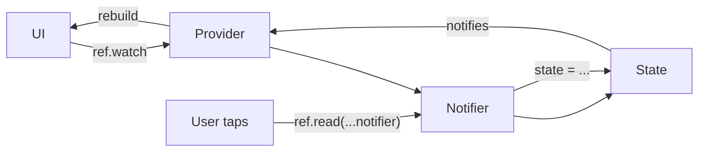

> 📌 **Riverpod 3 note:** older tutorials teach `StateProvider`, `StateNotifierProvider`, and `ChangeNotifierProvider`. In Riverpod 3 these moved to a **legacy** import (`package:flutter_riverpod/legacy.dart`). Learn `Notifier` / `AsyncNotifier` instead — they're what the generator produces anyway.

### Step 5 — State must be *replaced*, not mutated (hello again, Freezed!)

Our favorites:

```dart
class FavoritesNotifier extends Notifier<Set<String>> {
  @override
  Set<String> build() => getIt<PreferencesService>().favoriteIds;

  Future<void> toggle(String id) async {
    final next = {...state};                       // copy
    next.contains(id) ? next.remove(id) : next.add(id);
    state = next;                                  // assign a NEW set → UI updates
    await getIt<PreferencesService>().saveFavorites(next);
  }
}

final favoritesProvider =
    NotifierProvider<FavoritesNotifier, Set<String>>(FavoritesNotifier.new);
```

> ❌ `state.add(id)` would mutate the existing set. Riverpod compares old and new state, sees the same object, and **doesn't rebuild**. Same reason Freezed models are immutable.

### Step 6 — `AsyncNotifier`: loading + data + error for free

Real data arrives *later*. `AsyncNotifier` wraps your state in an `AsyncValue` with three possible faces:

```text
AsyncValue<List<Restaurant>>
├── loading
├── data(list)
└── error(e, stackTrace)
```

```dart
class RestaurantsNotifier extends AsyncNotifier<List<Restaurant>> {
  @override
  Future<List<Restaurant>> build() => getIt<RestaurantRepository>().getAll();

  Future<void> refresh() async {
    state = const AsyncLoading();
    state = await AsyncValue.guard(() => getIt<RestaurantRepository>().getAll());
  }
}

final restaurantsProvider =
    AsyncNotifierProvider<RestaurantsNotifier, List<Restaurant>>(
  RestaurantsNotifier.new,
);
```

### Step 7 — Render all three faces with one call

```dart
final restaurants = ref.watch(restaurantsProvider);

return restaurants.when(
  loading: () => const Center(child: CircularProgressIndicator()),
  error: (e, st) => Center(child: Text('Oops: $e')),
  data: (list) => ListView.builder(
    itemCount: list.length,
    itemBuilder: (_, i) => ListTile(title: Text(list[i].name)),
  ),
);
```

Compare this with the `FutureBuilder` from Mission 3. No manual `isLoading` flags, no forgotten error state. **This is the single most useful pattern in the chapter.**

### Step 8 — Side effects with `ref.listen`

```dart
ref.listen(restaurantsProvider, (previous, next) {
  if (next.hasError) {
    ScaffoldMessenger.of(context).showSnackBar(
      const SnackBar(content: Text('Could not load restaurants')),
    );
  }
});
```

## ⚠️ Traps

- **`ref.read` in `build`** → UI never updates.
- **Mutating state in place** (`state.add(...)`) → no rebuild.
- **Doing side effects inside `build`** (navigating, showing snackbars) → use `ref.listen`.
- **Forgot `ProviderScope`** → "No ProviderScope found."
- **Surprise retries (Riverpod 3):** failed providers are retried automatically by default, so a "broken" API may seem to keep loading. The retry behavior is configurable — look up `retry` in the Riverpod 3 docs before you demo error states to students.

## ✅ Checkpoint

1. In an `onPressed`, do you use `ref.watch` or `ref.read`? Why?
2. What are the three states of an `AsyncValue`?
3. Why does `state.add(id)` fail to update the UI?
4. Where do navigation and snackbars belong: `build` or `ref.listen`?

<details>
<summary>👀 Answers</summary>

1. `ref.read` — a callback shouldn't subscribe to changes.
2. Loading, data, error.
3. The `Set` is the same object, so Riverpod sees no change. Assign a new one.
4. `ref.listen` — `build` should be a pure description of UI.
</details>

## 🎯 Mission 8 — Replace the FutureBuilder

1. Wrap the app in `ProviderScope`.
2. Replace Mission 3's `FutureBuilder` with `restaurantsProvider` + `.when(...)`.
3. Replace Mission 4's manual favorites logic with `favoritesProvider`. Show the ❤️ count in the app bar from a *different* screen to prove state is shared.
4. Add pull-to-refresh calling `restaurantsProvider.notifier.refresh()`.

**Done when:** toggling ❤️ on the list instantly updates the count on the Map screen.

## 🏆 Boss Level

Move the login guard from `ValueNotifier` to Riverpod: create an `AuthNotifier` (using your `AuthState`) and give `GoRouter` a `refreshListenable` driven by it. *(Hint: a `routerProvider` that listens to auth and notifies the router.)*

---
---

# 9. 🪄 Riverpod Generator

## 🧩 The Problem

Look at how much ceremony the manual way needs:

```dart
final counterProvider =
    NotifierProvider<CounterNotifier, int>(CounterNotifier.new);
```

Multiply by 40 providers and you're typing a lot of boilerplate (and picking the wrong provider type sometimes).

## 💡 The Idea

> **Write the logic, add `@riverpod`, and the generator picks the right provider type for you.**

> 🎓 **Teaching rule:** understand the manual API first (Chapter 8), *then* use the generator. Otherwise `@riverpod` is just magic stickers on code.

## 🛠️ Build It

### Step 1 — Install

```bash
flutter pub add riverpod_annotation
flutter pub add --dev riverpod_generator build_runner
```

### Step 2 — Manual vs generated, side by side

| Manual | Generated |
|---|---|
| `NotifierProvider<CounterNotifier, int>(CounterNotifier.new)` | `@riverpod class Counter extends _$Counter { … }` |

```dart
import 'package:riverpod_annotation/riverpod_annotation.dart';

part 'favorites_provider.g.dart';

@Riverpod(keepAlive: true)
class Favorites extends _$Favorites {
  @override
  Set<String> build() => getIt<PreferencesService>().favoriteIds;

  Future<void> toggle(String id) async {
    final next = {...state};
    next.contains(id) ? next.remove(id) : next.add(id);
    state = next;
    await getIt<PreferencesService>().saveFavorites(next);
  }
}
```

```bash
dart run build_runner watch --delete-conflicting-outputs
```

You now use **`favoritesProvider`** — the name is derived from the class: `Favorites` → `favoritesProvider`.

```dart
final favorites = ref.watch(favoritesProvider);
ref.read(favoritesProvider.notifier).toggle('2');
```

### Step 3 — Functions become providers too

For **read-only** values (no mutation), a plain function is enough:

```dart
@riverpod
Future<List<Restaurant>> nearbyRestaurants(Ref ref) async {
  final all = await ref.watch(restaurantsProvider.future);
  return all.where((r) => r.isOpen).toList();
}
```

Rule of thumb:

| You need… | Write… |
|---|---|
| Just compute / fetch a value | a `@riverpod` **function** |
| State you can change with methods | a `@riverpod` **class** |

### Step 4 — Naming gotcha

Don't name a notifier class the same as your model. A class `User extends _$User` collides with your Freezed `User` model — call the notifier `Session`, `CurrentUser`, or `UserController`.

## ⚠️ Traps

- **Generated providers auto-dispose by default.** If state vanishes when you leave a screen, that's why — use `@Riverpod(keepAlive: true)` for state that must live as long as the app (auth, favorites, theme).
- **Forgot the `part '….g.dart';` line** → `_$Favorites` undefined.
- **Forgot to re-run the generator** → code compiles against stale providers.
- **Two builders fighting** (Freezed + Riverpod both use `build_runner`) — they coexist fine; just run one `build_runner` command.

## ✅ Checkpoint

1. What provider name is generated for `class Settings extends _$Settings`?
2. Your favorites reset every time you navigate away. First suspect?
3. Function or class: a provider that returns today's date?

<details>
<summary>👀 Answers</summary>

1. `settingsProvider`.
2. Auto-dispose — add `keepAlive: true`.
3. A function; there's nothing to mutate.
</details>

## 🎯 Mission 9 — Convert, don't rewrite

Convert `favoritesProvider` and `restaurantsProvider` to `@riverpod`. Your screens should need **almost no changes** — if they do, you renamed something.

**Done when:** the app behaves identically and the old `NotifierProvider(...)` declarations are gone.

---
---

# 10. 👨‍👩‍👧 Riverpod Families

## 🧩 The Problem

The details page for restaurant `42` and restaurant `7` need **different** state — but it's the same *kind* of provider.

```text
restaurantProvider('1')
restaurantProvider('2')
restaurantProvider('3')   ← one blueprint, many instances
```

## 💡 The Idea

> **A family is a provider that takes parameters. The parameter becomes part of the provider's identity.**

## 🛠️ Build It

With the generator, a family is just a function with extra parameters:

```dart
@riverpod
Future<Restaurant> restaurant(Ref ref, String id) {
  return getIt<RestaurantRepository>().getById(id);
}
```

Use it:

```dart
final restaurant = ref.watch(restaurantProvider('42'));
```

And now **Chapter 1 meets Chapter 10**:

```dart
GoRoute(
  path: ':id',
  builder: (context, state) =>
      RestaurantDetailsScreen(id: state.pathParameters['id']!),
),
```

```dart
class RestaurantDetailsScreen extends ConsumerWidget {
  const RestaurantDetailsScreen({super.key, required this.id});
  final String id;

  @override
  Widget build(BuildContext context, WidgetRef ref) {
    final restaurant = ref.watch(restaurantProvider(id));
    return Scaffold(
      appBar: AppBar(title: const Text('Details')),
      body: restaurant.when(
        loading: () => const Center(child: CircularProgressIndicator()),
        error: (e, _) => Center(child: Text('$e')),
        data: (r) => Center(child: Text('${r.name} — ⭐ ${r.rating}')),
      ),
    );
  }
}
```

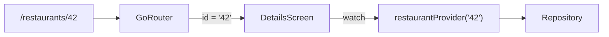

The manual version, for comparison:

```dart
final restaurantProvider =
    FutureProvider.family<Restaurant, String>((ref, id) {
  return getIt<RestaurantRepository>().getById(id);
});
```

## ⚠️ Traps

- **Parameters must have correct equality.** Riverpod decides "same provider or new one?" by comparing parameters with `==`. Strings and numbers are fine; **Freezed objects are fine too** (thanks, Chapter 2!); a hand-written class without `==` creates a new provider on every rebuild.
- **Putting huge objects in parameters.** Pass an `id`, let the provider fetch the rest.

## ✅ Checkpoint

1. Are `restaurantProvider('1')` and `restaurantProvider('2')` the same provider instance?
2. Why is a Freezed model a safe family parameter, and a plain class often not?

<details>
<summary>👀 Answers</summary>

1. No — different parameters, separate state.
2. Freezed generates value equality; a plain class compares by identity.
</details>

## 🎯 Mission 10 — Details that actually load

Make the details page load via `restaurantProvider(id)`. Add a ❤️ button wired to `favoritesProvider`.

**Done when:** opening `/restaurants/2` directly (deep link / hot restart on that page) shows the right restaurant.

---
---

# 11. ⚖️ Riverpod vs get_it — which one do I use?

Students always ask. Here's the honest answer.

| | `get_it` | Riverpod |
|---|---|---|
| Main job | Service locator / DI | Reactive state **and** DI |
| UI rebuilds when value changes? | ❌ No | ✅ Yes |
| Async / loading / error built in? | ❌ No | ✅ `AsyncValue` |
| Auto-cleanup of unused objects | ❌ Manual | ✅ Auto-dispose |
| Needs `BuildContext` / `ref`? | No — global | Needs `ref` |
| Testing | `getIt.reset()` + re-register | `ProviderContainer(overrides: [...])` |

Riverpod can be your **entire dependency graph**:

```dart
@Riverpod(keepAlive: true)
ApiClient apiClient(Ref ref) => FakeApiClient();

@Riverpod(keepAlive: true)
RestaurantRepository restaurantRepository(Ref ref) =>
    RestaurantRepository(ref.watch(apiClientProvider));
```

Then providers use it:

```dart
@riverpod
Future<List<Restaurant>> restaurantList(Ref ref) =>
    ref.watch(restaurantRepositoryProvider).getAll();
```

**My recommendation:** in a *new* Riverpod project, you probably don't need `get_it` at all — two systems for the same job is extra cognitive load. **But teach `get_it` anyway**, because you'll meet it constantly in existing codebases, and because seeing the same problem solved twice makes the *idea* of DI click.

## 🎯 Mission 11 — Migrate one thing

Move `ApiClient` and `RestaurantRepository` from `get_it` into Riverpod providers (above). Delete their `getIt.register...` lines. Everything else keeps working.

**Done when:** you can write a test that overrides `apiClientProvider` with a failing fake in **3 lines**:

```dart
final container = ProviderContainer(overrides: [
  apiClientProvider.overrideWithValue(FailingApiClient()),
]);
```

---

# 12. 🏛️ Putting It All Together — Architecture

You now know nine tools. Here's how they fit into one clean design.

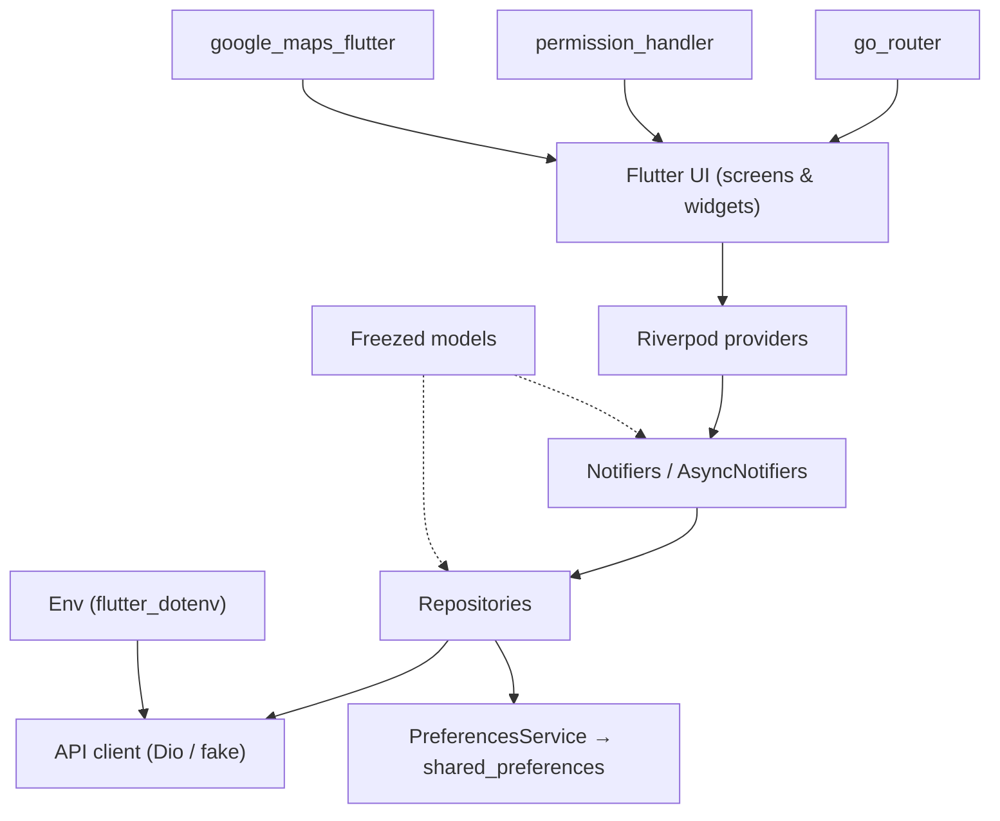

### The one rule that keeps it clean

> **Arrows point down. UI never talks to the API. Repositories never know about widgets.**

| Layer | Owns | Never touches |
|---|---|---|
| **UI** | Widgets, layout | HTTP, storage |
| **Providers / Notifiers** | State, loading/error | Widgets, `BuildContext` |
| **Repositories** | Data rules (fetch, cache, map JSON → models) | UI, navigation |
| **Data sources** | HTTP, `shared_preferences`, platform APIs | Business rules |

### Suggested project structure

```text
lib/
├── main.dart
├── app/
│   ├── app.dart            # MaterialApp.router
│   ├── router.dart         # go_router config
│   └── env.dart            # Env class
├── core/
│   ├── api/                # ApiClient (+ fake)
│   ├── storage/            # PreferencesService
│   └── errors/
└── features/
    ├── auth/
    │   ├── models/         # AuthState, User (Freezed)
    │   ├── providers/
    │   └── presentation/
    ├── restaurants/
    │   ├── data/           # RestaurantRepository
    │   ├── models/         # Restaurant (Freezed)
    │   ├── providers/      # restaurants, restaurant(id), favorites
    │   └── presentation/
    ├── map/
    │   ├── providers/
    │   └── presentation/
    └── settings/
        ├── providers/
        └── presentation/
```

> 📁 **Feature-first** (group by feature, not by type) means deleting or onboarding a feature touches one folder instead of five.

---
---

# 13. 🏁 Final Project — Local Food Explorer

No more isolated demos. You've been building this all along — now polish it into something you'd put in a portfolio.

### The user journey

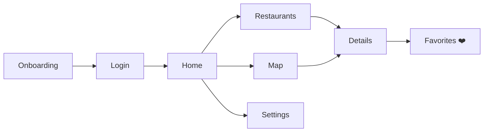

### Where each package earns its place

| Package | Role in the app |
|---|---|
| `go_router` | All navigation, deep links, login guard, route parameters |
| `freezed` | `Restaurant`, `User`, `AuthState` |
| `get_it` | (Starting point) services — migrated to Riverpod in Ch 11 |
| `shared_preferences` | Onboarding flag, favorites, theme |
| `permission_handler` | Location permission |
| `google_maps_flutter` | Restaurant map with tappable markers |
| `flutter_dotenv` | Dev / staging / prod configuration |
| `flutter_riverpod` + generator | All application state |

### ✅ Definition of Done

**Navigation**
- [ ] Opening the app unauthenticated lands on `/login`
- [ ] `/restaurants/:id` works as a cold deep link
- [ ] Back button behaves sensibly everywhere

**Data & state**
- [ ] Loading, error, and data states all visible on the list screen
- [ ] Favorites survive app restart
- [ ] Favorite count stays in sync across screens

**Device & maps**
- [ ] All three location-permission outcomes handled
- [ ] Markers open the right details page

**Config & quality**
- [ ] `--dart-define=ENV=dev|staging|prod` visibly changes behavior
- [ ] No secrets committed; `.env.example` present
- [ ] At least **3 tests** (e.g. `Restaurant` equality, `FavoritesNotifier.toggle`, repository with a fake `ApiClient`)

### 🚀 Stretch goals

1. 🔎 Search + cuisine filter chips (state in a Notifier, filter as a derived provider)
2. 🌙 Dark mode saved in preferences
3. 📶 "Offline" fake API that throws — show a retry button
4. 🧪 A `ProviderContainer` test that overrides the API to fail
5. 🏷️ Real flavors (`dev` / `staging` / `prod`) with different app names and icons

### 🧑‍🏫 Instructor rubric (100 pts)

| Area | Points | Look for |
|---|---|---|
| Architecture & folder structure | 20 | Layers respected, no UI → API calls |
| State management | 20 | `AsyncValue` handled, immutable updates |
| Navigation | 15 | Nested routes, params, redirect |
| Models | 10 | Freezed used meaningfully (union state, not just `copyWith`) |
| Device + maps | 15 | Permission edge cases, markers wired to data |
| Config & hygiene | 10 | Env switching, `.gitignore`, no leaked keys |
| Tests | 10 | Meaningful, passing |

---
---

# 14. 🧠 The Final Mental Model

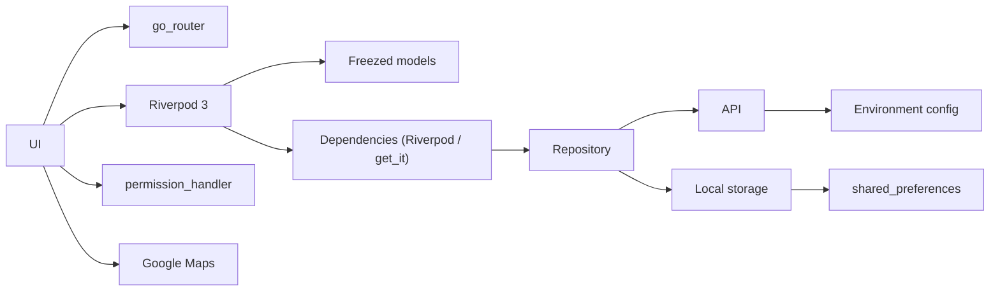

## 🗂️ One-page cheat sheet

| Problem | Reach for | Key idea |
|---|---|---|
| "How do screens find each other?" | `go_router` | URLs + nested routes + redirect |
| "How do I model data safely?" | `freezed` | Immutable, equal-by-value, sealed states |
| "Who creates my services?" | `get_it` / Riverpod | Inject, don't construct |
| "How do I remember small things?" | `shared_preferences` | Key-value notebook (not a database) |
| "Can I use the camera/GPS?" | `permission_handler` | Plan for granted / denied / blocked |
| "Show things on a map" | `google_maps_flutter` | Markers derived from data |
| "Dev vs staging vs prod?" | `flutter_dotenv` | Code constant, config varies |
| "Who owns app state?" | Riverpod | `watch` in build, `read` in callbacks |
| "Too much provider boilerplate" | Riverpod generator | `@riverpod`, but understand it first |
| "Same provider, different data" | Families | Parameter = identity |

## 🎓 What you should be able to say now

You're **not** done when you can say:

> "I know nine Flutter packages."

You're done when you can say:

> **"I understand the problems these packages solve, and I can combine them into a Flutter app that someone else can maintain."**

Now go build something delicious. 🍽️
